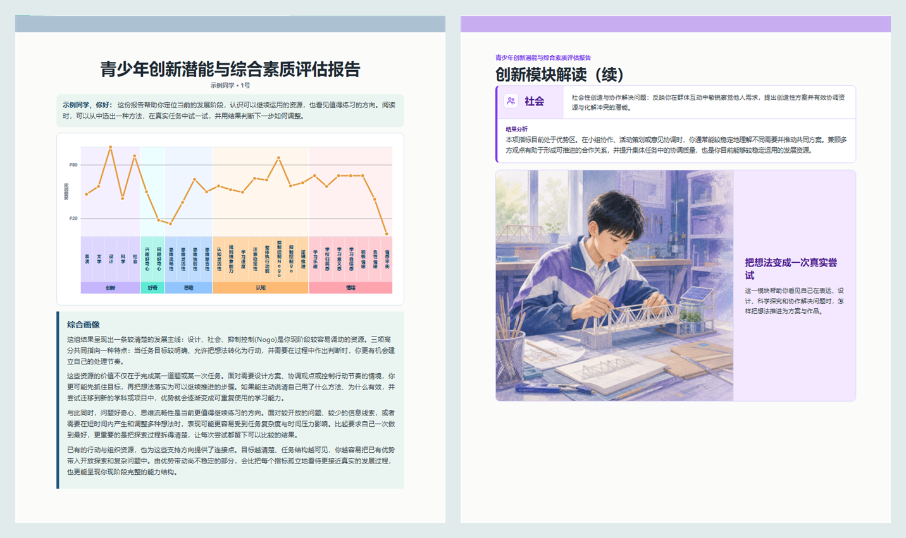
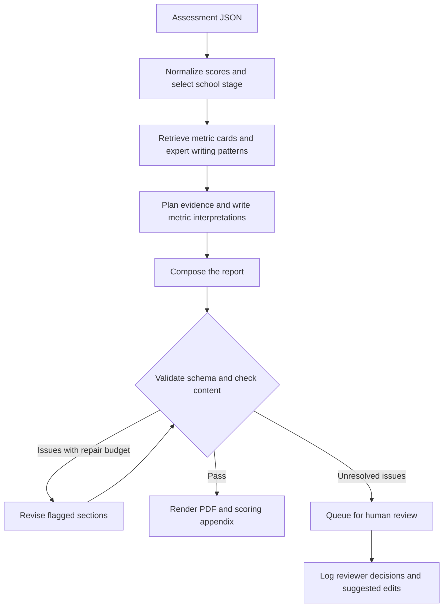

# PsychReportAgent

**A modular multi-agent system for student assessment reporting**

PsychReportAgent turns structured psychological and cognitive assessment scores into illustrated Chinese-language PDF reports. It helps families and students understand what an assessment measured, how to interpret the results, and what they might try next. The system combines expert writing guidance, deterministic scoring rules, and local human review.

`Python` · `DeepSeek` · `LangGraph (opt-in)` · `Local RAG` · `Playwright`

[中文说明](README.zh-CN.md) · [Demo PDF](docs/showcase/junior-high-demo.pdf) · [Synthetic input](samples/sample_synthetic_junior_high_demo.json) · [Console guide](docs/report_operations_console.md)

This public edition includes the pipeline source, reusable writing rules, and synthetic examples. Student records, reviewer notes, and the internal expert corpus are kept in a separate private repository.

## Report preview



The preview uses invented scores and scripted text to demonstrate the PDF renderer and report structure. The offline demo also generates a separate scoring appendix locally.

## How it works



- **Scoring and evidence.** Code maps raw scores to configured bands and supplies metric definitions. The model explains the results in language suited to the selected audience.
- **Skills and retrieval.** Reusable writing instructions define style and evidence constraints. The local reference library supplies metric cards and writing patterns selected for each report.
- **Checking and revision.** Schema validation, deterministic rules, and an LLM checker flag missing indicators, mismatched score bands, and unsupported claims. Repair agents can revise the flagged sections within a fixed round limit.
- **Operator review.** A Windows-friendly local console runs batches, shows report artifacts and check results, and records human decisions on individual issues. LangGraph orchestration is available as an opt-in implementation alongside the default Python runner.

## Development and validation

| Area | What the project covers |
| --- | --- |
| Expert materials | 30 revised reports, four writing guides, and 30 annotated reviews informed the writing skills, evaluation rubric, and retrieval references. |
| Report structure | Reference definitions for 26 indicators, school-stage-specific language, charts, a standalone scoring appendix, and traceable JSON outputs. |
| Testing | Five synthetic student profiles for writing comparisons and 37 automated tests for orchestration, normalization, feedback storage, and the console. |

Internal checks measure consistency with the configured rubric. Reader usefulness and psychometric validity require separate evaluation.

## Run locally

On Windows, run `SETUP_FIRST_TIME.cmd` once and then open `OPEN_REPORT_CONSOLE.cmd`. The local console listens on `127.0.0.1`. A DeepSeek API key is required for model-based generation.

For an offline preview, activate the project Python environment and run:

```powershell
npm run preview:junior -- --output-dir output/showcase
node scripts/render_report_variants_from_text_batch.js output/showcase/text_agent output/showcase/samples output/showcase/pdf hybrid_expert_dashboard
npm test
```

The report PDF and separate scoring appendix are written under `output/showcase/pdf/`. Use the [synthetic JSON input template](templates/README.md) to explore the batch console.

This is an educational assessment reporting prototype. Its reports are non-diagnostic. Project files and expert materials remain subject to their respective permissions.
